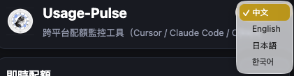
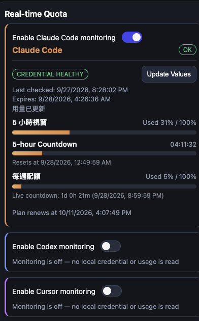
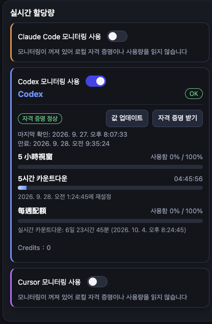
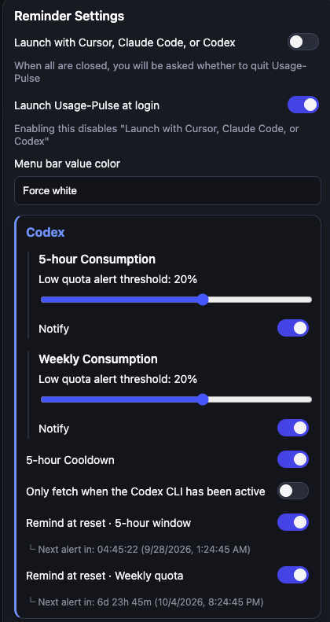
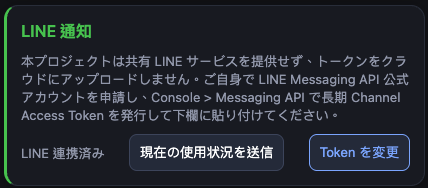
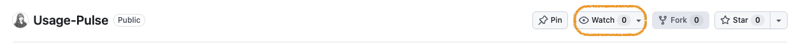

# Usage-Pulse

**English** | [繁體中文](README.zh-TW.md) | [日本語](README.ja.md) | [한국어](README.ko.md)

[](LICENSE)

Usage-Pulse is a cross-platform desktop menu bar tool that monitors Cursor, Claude Code, and Codex quotas, sending notifications when quota changes, runs low, or resets.

It only reads credentials you're already logged in with locally and official usage data — it never writes back to any IDE's credential or config files.

## Screenshots

<table>
  <tr>
    <td><br/><sub>Switch the in-app language anytime</sub></td>
    <td><br/><sub>Real-time quota for Cursor, Claude Code, and Codex</sub></td>
  </tr>
  <tr>
    <td><br/><sub>Same quota view, shown here in Korean</sub></td>
    <td><br/><sub>Fine-grained reminder settings per service</sub></td>
  </tr>
  <tr>
    <td><br/><sub>Optional LINE notifications</sub></td>
  </tr>
</table>

## Installation

### Download

Grab the latest build from the [Releases page](https://github.com/xiaochen26wyl/Usage-Pulse/releases):

- Apple Silicon (M1/M2/M3...): `Usage-Pulse-<version>-arm64.dmg`
- Intel Mac: `Usage-Pulse-<version>.dmg` (or the x64-labeled file)
- Windows x64: `Usage-Pulse.Setup.<version>.exe`

### Run from source

Usage-Pulse is open source — you can clone the repository, read the code yourself, and run it directly.

Click **Watch** (not just Star) at the top of this repository so GitHub notifies you about every new release:



Requires [Node.js](https://nodejs.org/) 24 and pnpm 9.15.9 (run `corepack enable` once and pnpm picks the right version automatically).

```bash
git clone https://github.com/xiaochen26wyl/Usage-Pulse.git
cd Usage-Pulse
pnpm install
pnpm dev
```

`pnpm dev` starts the app in development mode; the menu bar icon works the same as the installed version, and the logins listed in **Before first use** are still required.

A fresh clone already checks out and tracks the `main` branch. Since every release is published as a tag off `main`, run `git pull` before rebuilding to pick up the changes behind each new release.

### Local environment files 本機環境檔

Usage-Pulse does not need an environment file, so do not create a `.env`.
Usage-Pulse 不需要環境檔，請不要建立 `.env`。

Provider logins are read from your existing local logins; optional notification credentials entered in the app are stored encrypted on your machine.
各服務的登入沿用你本機既有的登入；在 app 內填入的選用通知憑證會加密存放在你的電腦上。

### Unsigned build warnings

- macOS Gatekeeper: on first launch, right-click the app in Finder -> `Open` -> click `Open` again.
- Windows SmartScreen: if a protection prompt appears, choose `More info` -> `Run anyway`.

### Before first use

- Log in to **Cursor Desktop** first (required for Cursor quota reads).
- Install the **standalone Claude Code CLI** and log in with it first.
- Log in to the **Codex CLI** or **Codex Desktop** first (Usage-Pulse does not open a Codex login UI).
- Allow system notification permissions when prompted.

> Usage-Pulse does not read the Claude Desktop app's internal (encrypted) session. Even if you only use Claude through the Claude Desktop app day to day, you still need a Claude Code login saved via the official CLI.

### Claude Code credential setup

Click **Update Values** in Usage-Pulse to detect the credential and fetch usage. Whenever the Claude card has no numbers to show, it opens a panel on the spot with the exact login command to run and a box you can paste a token into instead.

A pasted token is tried against your real usage before it is kept: if it can't read your usage, it isn't saved and the panel tells you why.

> Why the numbers can look different from Claude Desktop's own "Plan usage limits" panel: Usage-Pulse shows **remaining** quota, while Claude Desktop's panel shows **used** quota. `44%` remaining and `56%` used describe the same state — not a data error.

## Behavior

1. Checks Cursor / Claude Code / Codex quota periodically in the background and alerts you on changes.
2. Low-quota and quota-reset alerts can each be toggled independently, per service and per window, in Settings.
3. Two notification channels, chosen separately for each of Cursor, Claude Code, and Codex in Settings: an in-app popup (no OS permission needed, always works — top-right, auto-closes after 30 seconds) and LINE notifications (needs a Channel Access Token).
4. Available in Traditional Chinese, English, Japanese, and Korean from the in-app language menu.
5. Quit anytime from the UI or the tray menu; if LINE is on, quitting sends a final status from the last cached reading.
6. Windows builds check for new releases automatically (toggle in Settings, or use **Check for Updates** in the tray menu) and only download or install after you confirm. macOS builds don't self-update — grab new versions from the Releases page.

## Security notes

- What's read, all read-only: Cursor's local session file, the official Claude Code CLI's saved login, and Codex's local auth file.
- Usage-Pulse never writes to or modifies any of these files or credentials.
- The one exception is the Clear older than 2 weeks button on the Claude Code and Codex cards. It acts only when you click it and confirm: only conversations not updated in over 2 weeks are removed (pinned Codex conversations are kept), their files go to the Trash, and Codex's database records for them are deleted permanently; if Codex is open you get a second warning first.
- General settings (notification toggles, language, and the rest of Settings) are stored locally only — there's no cloud sync.

If anything appears incorrect — such as a reading that seems wrong, a notification that should not have been triggered, or any other unexpected behavior — please open a question in [Discussions Q&A](https://github.com/xiaochen26wyl/Usage-Pulse/discussions/categories/q-a-%E8%A7%A3%E6%B1%BA%E5%95%8F%E9%A1%8C) instead of making assumptions.

## 品牌配色（Brand colors）

本節列出 Usage-Pulse 介面**全部**已定義的色票，供設計與 Logo 取色。單一來源是 [`src/renderer/styles.css`](src/renderer/styles.css) 的 `:root` token（`--color-*`）；介面只有一組深色配色，沒有淺色變體。品牌主色由使用者確認，色碼一律取自該檔。

> **維護規則**：新增、修改或刪除色票時，必須同步更新本節；色碼與 [`src/renderer/styles.css`](src/renderer/styles.css) 不一致就是文件錯誤。

### 主要配色（Logo 取色）

| 角色 | 色碼 | 說明 |
|---|---|---|
| Primary 主色 | `#3B82F6` | 品牌主色（`--color-primary`） |
| Primary Strong 深主色 | `#2563EB` | 主色的加深版本（`--color-primary-strong`） |

### 完整色票

色碼全部取自上述 `:root`，用腳本產生；依用途分組。

#### 品牌色

| Token | 色碼 | 說明 |
|---|---|---|
| `--color-primary` | `#3B82F6` | 品牌主色 |
| `--color-primary-strong` | `#2563EB` | 主色的加深版本 |

#### 狀態色

| Token | 色碼 | 說明 |
|---|---|---|
| `--color-warning` | `#6CB6FF` | 警告 |
| `--color-success` | `#59D090` | 成功 |
| `--color-danger` | `#FF7D7D` | 危險 |

#### 服務識別色

| Token | 色碼 | 說明 |
|---|---|---|
| `--color-line` | `#06C755` | LINE 綠 |
| `--color-line-strong` | `#05B34C` | LINE 深綠 |
| `--color-claude` | `#E8945A` | Claude 橘 |
| `--color-cursor` | `#C084FC` | Cursor 紫 |
| `--color-codex` | `#3F87F7` | Codex 藍 |

#### 文字與邊框

| Token | 色碼 | 說明 |
|---|---|---|
| `--color-text` | `#F5F6F8` | 內文 |
| `--color-text-muted` | `#9AA4B5` | 次要文字 |
| `--color-border` | `#2A3442` | 邊框 |

### 局部色／備註

以下是 [`src/renderer/styles.css`](src/renderer/styles.css) 裡直接寫死、沒有定義成 token 的顏色（依色碼與屬性合併，行號為撰寫當下該檔的行號），不屬於上面的正式色票：

| 色碼 | 屬性 | 行號 |
|---|---|---|
| `#0E1116` | `background` | L27 |
| `#10141B` | `background` | L309 |
| `#11161D` | `background` | L130 |
| `#181D25` | `background` | L40, L590, L598 |
| `#1F2328` | `background` | L508 |
| `#1F2328` | `border-color` | L509 |
| `#1F2328` | `color` | L504 |
| `#212833` | `background` | L641 |
| `#243142` | `background` | L419 |
| `#2B3442` | `background` | L197, L338 |
| `#304157` | `background` | L424 |
| `#314157` | `border` | L127 |
| `#334155` | `border` | L308 |
| `#3F4F65` | `border` | L337, L415 |
| `#6CB6FF` | `color` | L564 |
| `#8B949E` | `color` | L559, L582 |
| `#B5BDCA` | `border-color` | L242 |
| `#B5BDCA` | `color` | L243 |
| `#BFDBFE` | `background` | L214 |
| `#C5DDFF` | `color` | L525 |
| `#E9D5FF` | `background` | L210 |
| `#F0B27A` | `background` | L206 |
| `#F5F6F8` | `background` | L351 |
| `#F5F6F8` | `color` | L28, L298, L310, L383, L397 |
| `#FFFFFF` | `background` | L502 |
| `#FFFFFF` | `border-color` | L503 |
| `#FFFFFF` | `color` | L82, L418, L442, L498, L510, L614 等 9 處 |
| `rgba(0, 0, 0, 0.25)` | `background` | L539 |
| `rgba(108, 182, 255, 0.12)` | `background` | L472, L524 |
| `rgba(255, 125, 125, 0.12)` | `background` | L462 |

- `--color-warning` 的色碼是淺藍 `#6CB6FF`，與名稱的「警告」直覺不同；本節依來源檔照列，沒有更動。
- `--shadow-card`（L18）不是固定色碼：`0 4px 14px rgba(0, 0, 0, 0.28)`。

#### 選單列色（macOS 選單列繪圖）

選單列的圖片由主行程繪製，色碼定義在 [`src/shared/tray-value-color.ts`](src/shared/tray-value-color.ts)，不在 `styles.css`，因此另列於此；同樣依該檔照列。

| Token | 色碼 | 說明 |
|---|---|---|
| `TRAY_BACKGROUND_COLOR` | `#181D25` | 選單列圖片背景（同面板灰，四角小圓角） |
| `TRAY_VALUE_COLOR` | `#FFFFFF` | 主數值 |
| `TRAY_CURSOR_LABEL_COLOR` | `#C084FC` | Cursor 名稱（對應 `--color-cursor`） |
| `TRAY_CLAUDE_LABEL_COLOR` | `#E8945A` | Claude 名稱（對應 `--color-claude`） |
| `TRAY_CODEX_LABEL_COLOR` | `#3F87F7` | Codex 名稱（對應 `--color-codex`） |
| `TRAY_WEEKLY_COLOR` | `#FACC15` | 第二個數值（每週剩餘／Cursor 進階模型），各服務統一 |
| `TRAY_WEEKLY_LOW_COLOR` | `#FF5A5A` | 第二個數值剩 5% 以下（含耗盡倒數） |

## License and important notice

Usage-Pulse uses an **MIT-style license with a non-commercial default** (full terms in [`LICENSE`](LICENSE)). **Personal use and use within a company for the company's own internal purposes are both free.** Since it's provided free for company use, please have your company assess the security risk on its own before adopting it.

**Only download Usage-Pulse from this repository's official GitHub Releases page.** Builds from any other source are not published by the original developer, and their handling of your credentials cannot be trusted.

## Support

If Usage-Pulse has been helpful to you, please consider starring the project on GitHub ⭐ — it's free, quick, and greatly appreciated. You can also support the project via [GitHub Sponsors](https://github.com/sponsors/xiaochen26wyl).

## Follow Developer

- Instagram (English): [@xiaochen26wyl](https://www.instagram.com/xiaochen26wyl/)
- Threads (中文): [@xiaochen26wyl](https://www.threads.com/@xiaochen26wyl)

W.Y. LI — [LinkedIn](https://www.linkedin.com/in/wenyu-li-1a9868bb/) (commercial licensing & buyout)
